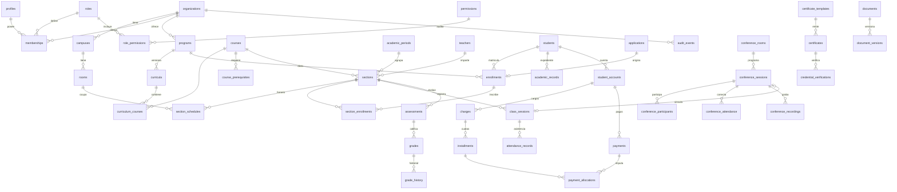

# SEMATEC GLOBAL 10.0 — Modelo de datos y trazabilidad

## Diagrama entidad-relación (núcleo)

Toda tabla operacional lleva `organization_id`; las relaciones entre tablas de una misma institución usan claves foráneas compuestas `(organization_id, id)`, de modo que la base de datos rechaza mezclar registros de dos instituciones aunque la aplicación fallara.

## Matriz de requisitos → implementación → prueba

| Requisito | Implementación | Prueba |
|---|---|---|
| Criterio 01 · Login real y rechazo de credenciales | Supabase Auth + `record_login_failure` (bloqueo a los 5 intentos en 15 min) | 02 |
| Criterio 02 · Institución con configuración persistente | `create_organization`, `organization_settings`, `org_setting()` | 02, 05 |
| Criterio 03 · Sin acceso cruzado entre organizaciones | RLS + FK compuestas + Storage por prefijo | 01, 03, 04, 05 |
| Criterio 04 · Roles en interfaz, servidor y BD | `has_permission(org, permiso, sede)`, 24 roles, 133 permisos | 01, 02 |
| Criterio 05 · Registro de estudiantes y profesores con validación | CHECK de correo, teléfono, fechas; unicidad de código y documento | 01 |
| Criterio 06 · Programa, curso, sección y horario | Restricciones de exclusión GiST (sala y profesor) | 03 |
| Criterio 07 · Matrícula persistente visible en otro dispositivo | Datos en PostgreSQL (no en el navegador) | Requiere prueba en la nube |
| Criterio 08 · Asistencia y calificaciones correctas | `attendance_pct`, `weighted_average`, `close_section_grades`, `amend_grade` | 03 |
| Criterio 09 · Cuotas y pagos con trazabilidad | `create_charge`, `register_payment`, `void_payment`, `refund_payment`, auditoría | 04, concurrencia |
| Criterio 10 · Certificado verificable | `issue_certificate`, `verify_certificate`, hash SHA-256, revocación | 05 |
| Criterio 11 · Sala real y estudiante autorizado se conecta | `authorize_conference_join` → token LiveKit (Edge Function pendiente) | 05 (autorización) |
| Criterio 13 · Respaldos restaurables | `backup_restore_test.sh` | respaldo |
| Criterio 14 · Auditoría de operaciones importantes | `audit_events` encadenada, inmutable, `verify_audit_chain` | 02, 04 |
| SEG-003 MFA administrativa | `roles.requires_mfa` + claim `aal` del JWT | 02, 04 |
| SEG-007 RLS | 64/64 tablas con RLS | todas |
| SEG-009/010 Revocación y suspensión | `revoke_membership`, `set_profile_status`, perfil bloqueado = sin acceso | 01, 02 |
| RF-012 Evaluar postulaciones | `decide_application` | 05 |
| RF-013 Cupos | `register_section` con bloqueo de fila | 03, concurrencia |
| RF-036 Beneficios | `benefits` + descuento en `create_charge` | 04 |
| RF-039 Conciliación | `reconcile_provider_payments` | 04 |
| RF-050 Requisitos de egreso | `graduation_status` | 03 |
| RF-052 Indicadores | `report_enrollment_summary`, `report_academic_summary`, `report_finance_summary` | 04, 05 |
| RF-064 Conferencias ↔ cursos y certificados | Salas por sección, traspaso de asistencia al libro de clases, certificado de asistencia | 05 |
| VID-004 Tokens temporales | `conference_access_grants`, `expires_at` ≤ 2 h | 05 |
| VID-009 Asistencia configurable | `conferences.min_attendance_pct` en configuración; unión de reconexiones | 05 |
| VID-013 Expulsar y bloquear | `ban_conference_participant` | 05 |
| VID-015 Sin acceso entre instituciones | Verificación de membresía en invitación e ingreso | 05 |
| INT-005/006 Monedas y tipos de cambio | `currencies`, `exchange_rates` (solo inserción, auditada) | — |
| INT-007 Escalas regionales | `grade_scales` (1.0–7.0 Chile, 0–20 Perú en el seed) | 03 |
| §5 anexo ciberseguridad · versionado y no destrucción | `document_versions` inmutable; disparadores anti-borrado en finanzas y certificados | 04, 05 |

## Reglas de cálculo documentadas

- **Asistencia de clase**: (presente + atraso) / (sesiones registradas − justificadas).
- **Nota final**: promedio ponderado, redondeado a los decimales de la escala; el acta exige que las ponderaciones sumen 100 % y que no falten notas.
- **Aprobación**: nota final ≥ nota mínima de la escala **y** asistencia ≥ mínimo de la sección.
- **Asistencia a conferencia**: tiempo conectado dentro del horario programado (uniendo reconexiones solapadas) ≥ porcentaje configurado.
- **Cuotas**: se truncan a la unidad mínima de la moneda y la última absorbe la diferencia, de modo que la suma sea exacta.
- **Imputación de pagos**: a la cuota con vencimiento más antiguo; los reembolsos liberan primero la cuota más reciente.
